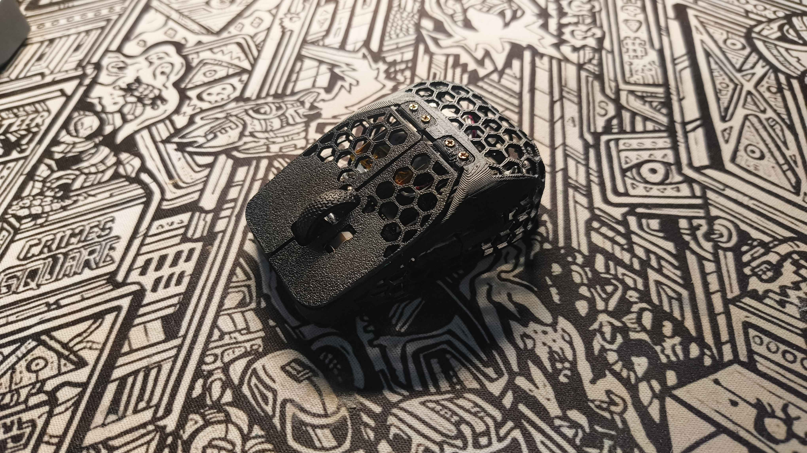
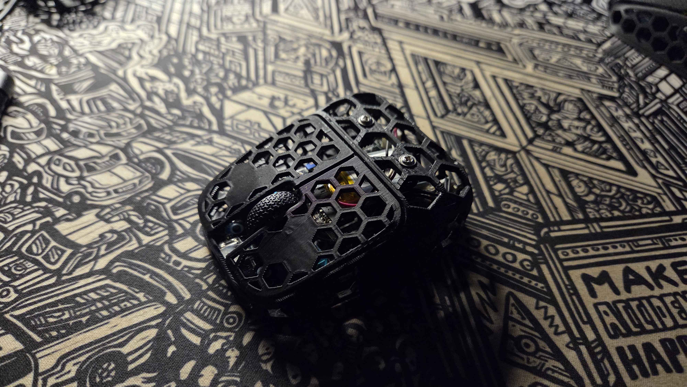
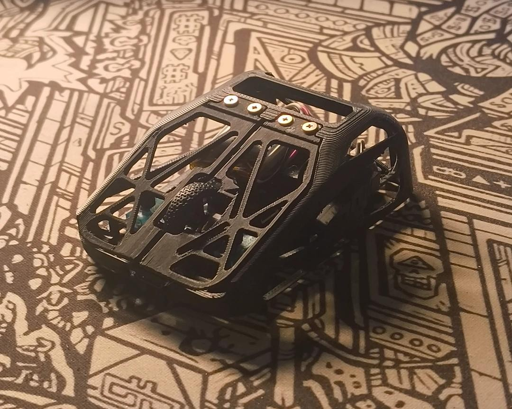
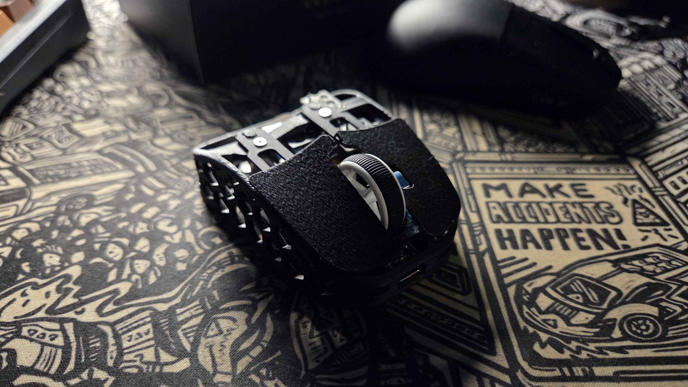
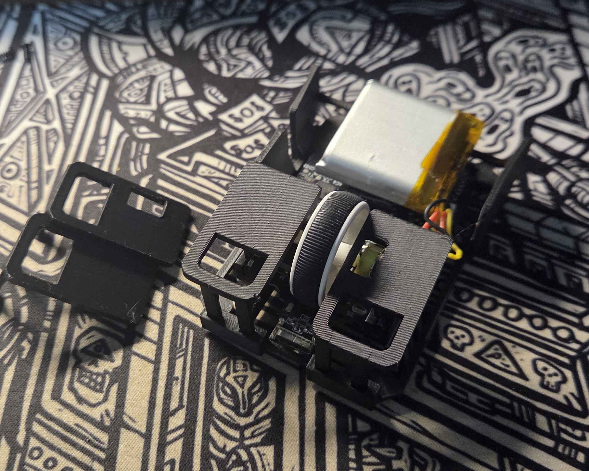

<!-- ABOUT THE PROJECT -->
## SlayCC's Fingertip Mouse Mod Collection

Fingerip Mouse is an underrated genre of mice in my opinion, and I am an avid fan of it. I started when I bought my first mice, the Logitech G304/G305. My hand naturally gravitated to fingertip because my palm doesn't reach the back. I stuck to it and trying palm and claw, it felt super restrictive only being able to move your whole wrist. The microadjustments a fingertip grip provides is amazing for the games I play which are movement based and fast paced.

These mods aim to bring Fingertip Style Mouse to more people by modifying cheaper mice as most of them go for 100$+ which is ridiculous to me. All of these are printed in PLA on my A1 Mini, but you can use whatever you prefer.

### Mice:
Currently, these are the Mice I have and have modded
<ul>
	<li> Keychron M4 - Cheapest dedicated Fingertip Mouse, Great for modding as Keychron open sources their designs. </li>
	<li> ATK VXE R1 SE+ - 20$ Gold Standard Mouse, so I decided to get one and mod it. </li>
	<li> Attack Shark X3 - Comissioned by my friend, not my mouse

<!-- GETTING STARTED -->
## Keychron M4 Mods

	<a href="Keychron%20M4/Keychron%20M4%20Hex%20Mod.step" width="80">
	<h3>Hex Mini</h3> </a>
	Original mod, shape is slightly thinner than the HSK Pro in width 52mm at sensor position, keeping most of the shape of the Original keychron m4 but without the dip in the sides, this gives that pen grip feel without beeing to narrow. This is also the mod I use the most.  
	<ul>
		<li>Print The Clicks Flat on the bed (Uses the bed texture)</li>
		<li>Side buttons Laying down with Normal Supports (The knobs touching the bed)</li>
		<li>Shell normal orientation with supports
	</ul>
	 
	<a href="Keychron%20M4/M4%20Asym.step" width="80">
	<h3>M4 Asym</h3> </a>
	Original mod, This one is shaped like the Fenrir Pro Asym. Slightly wider at 56mm closer to a real mouse with a dip for the pinky. Feels more comfortable but less pen-like for aiming  
	<ul>
		<li>Print The Clicks Sideways on the bed with supports (Middle side on bed)</li>
		<li>Side buttons Laying down with Normal Supports (The knobs touching the bed)</li>
		<li>Shell normal orientation with supports
	</ul>
	 
	<a href="Keychron%20M4/CarbonM4.stl" width="80">
	<h3>M4 Carbon</h3> </a>
	This is a Modified Version of u/MeanNectarine2311 design of the HSK Carbon made to fit for the M4 and addtional Weight Reduction. Too wide for my preferences but is super light. I didn't make this in fusion unfortunately so only STL 
	<ul>
		<li>Print The Clicks Sideways on the bed with supports (Middle side on bed)</li>
		<li>Side buttons Laying down with Normal Supports (The knobs touching the bed)</li>
		<li>Shell normal orientation with supports
	</ul>
	 
	<a href="Keychron%20M4/M4 Light.stl" width="80">
	<h3>M4 Light</h3> </a>
	This is a weight reduced version of the original shell, and a skeleton base. Reduces weight by like 4 grams or so. 
	<ul>
		<li>Clicks and side buttons are the same (or print another set)</li>
		<li>Base and Shell normal orientation with supports
	</ul>
	

## VXE R1 SE+

	<a href="VXE%20R1%20SE%2B/Vxe%20R1%20Se%2B%20Ftip%20Mod.step" width="80">
	<h3>VXE R1 Asym</h3> </a>
	Clicks from u/LEGENTOASTER design. Shell is 2 part screwed together by the base screws. Shape is similar to the asym but even wider at 59mm. Made this because most mods for the Mouse has the side buttons too far forward making the sensor position further back from the grip. This solves that problem by putting the buttons further back. 
	<ul>
		<li>Print The Clicks Sideways on the bed with supports (Middle side on bed)</li>
		<li>Side buttons Laying down with Normal Supports (The knobs touching the bed)</li>
		<li>Top and Bottom shell normal orientation with supports
	</ul>
	 
	<a href="VXE%20R1%20SE%2B/Vxe%20R1%20SE%20Asym.step" width="80">
	<h3>VXE R1 Asym</h3> </a>
	Similar to the Keychron Asym but taller since it is a full mouse mod. Shape is similar to the Fenrir Asym. 
	<ul>
		<li>Print The Clicks Sideways on the bed with supports (Middle side on bed)</li>
		<li>Side buttons Laying down with Normal Supports (The knobs touching the bed)</li>
		<li>Top and Bottom shell normal orientation with supports
	</ul>
	 

## Other

	<a href="Other/Zeromouse%20Attackshark%20x3.step" width="80">
	<h3>Zeromouse Attackshark X3</h3> </a>
	Friend wanted me to print a mod but the one he sent me was a zeromouse model some dude was selling for 9 god damn euros and its in cults of all places. So I made this, super simple and clean zeromouse mod that's free for anyone to try. 
	<ul>
		<li>Print The Clicks Sideways on the bed with supports (Middle side on bed)</li>
		<li>Base normal orientation with supports
	</ul>
	 

<!-- LICENSE -->
## License

Distributed under the CC0-1.0 License. My work is free for anyone to do what they please. See `LICENSE.txt` for more information.

<!-- CONTACT -->
## Suggestions

For any requests or suggestions, SlayCC on Discord or u/SlayCC on reddit.

Project Link: [https://github.com/SlayCC/Fingertip-Mouse-Mods](https://github.com/SlayCC/Fingertip-Mouse-Mods)

(<a href="#readme-top">back to top</a>)
